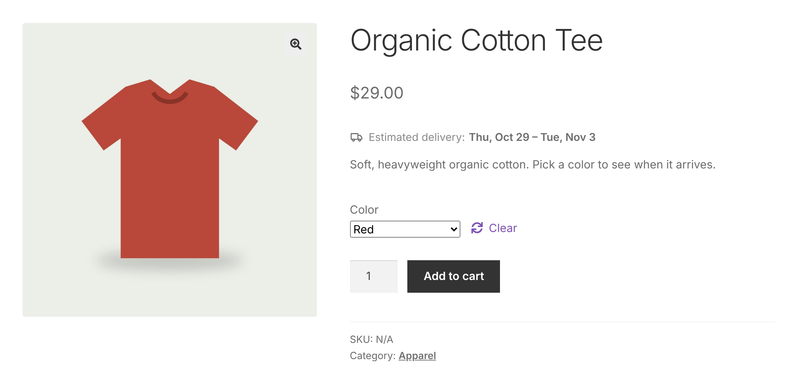
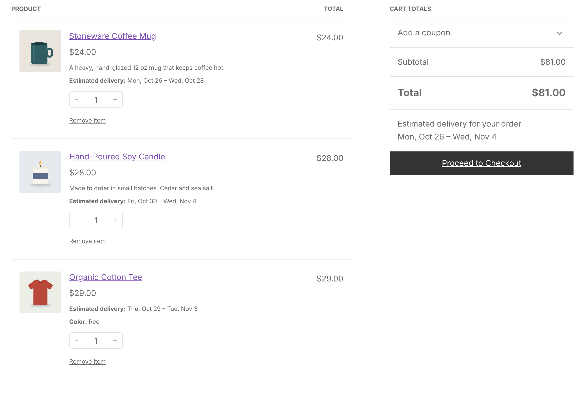
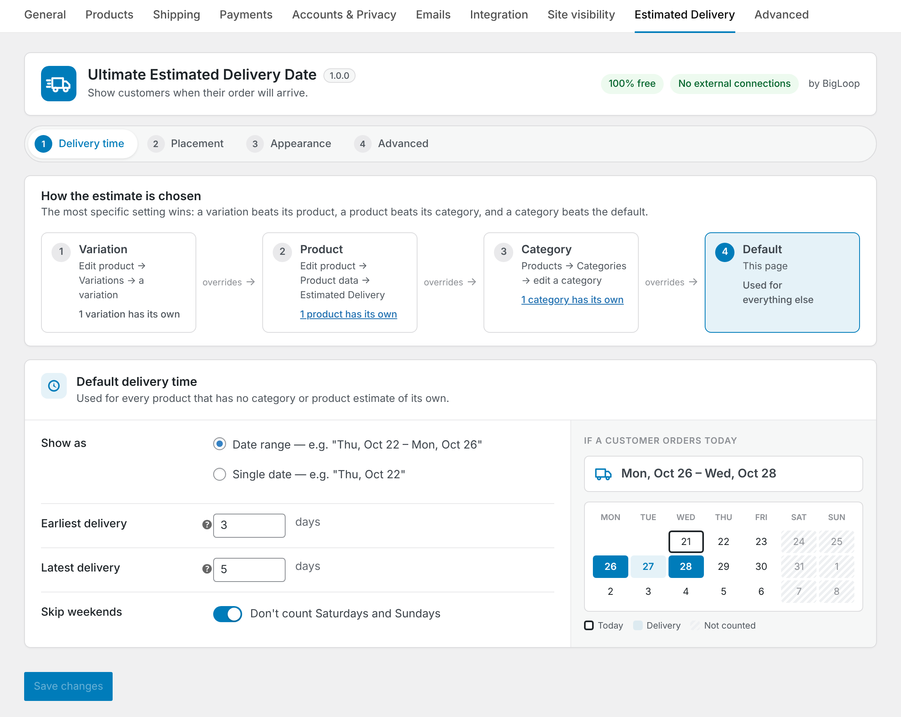
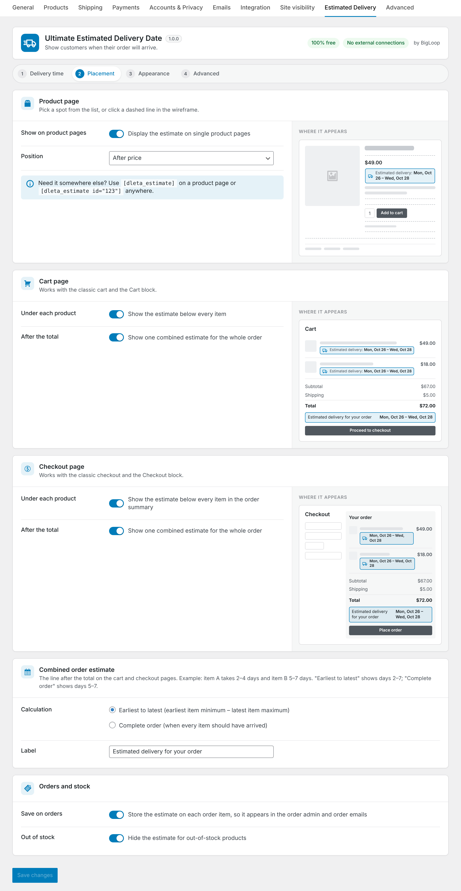
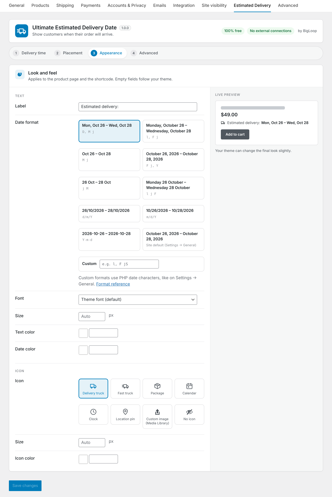
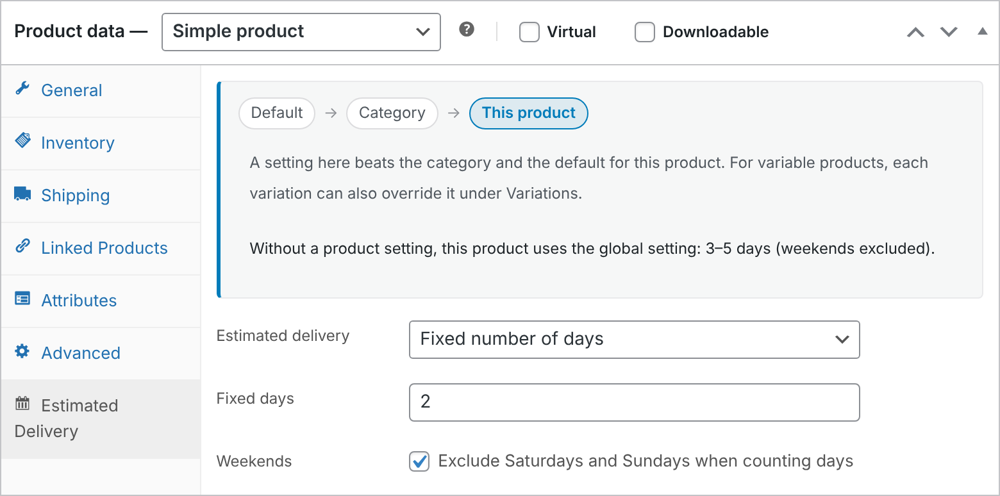

# Ultimate Estimated Delivery Date by BigLoop

Show customers when their order will arrive. A free WooCommerce plugin that adds an estimated delivery date to product pages, the cart, checkout and orders, for example **"Estimated delivery: Thu, Oct 22 – Mon, Oct 26"**.

Every feature is free, nothing is locked, and the plugin never contacts an outside server.

## Screenshots

| Product page | Cart and checkout |
| --- | --- |
|  |  |
| **Delivery time settings** with a live calendar | **Placement settings** with page wireframes |
|  |  |
| **Appearance settings** with a live preview | **Per-product override** in the product data tab |
|  |  |

## Features

- **Range or fixed days.** Show a date range (minimum and maximum days) or a single date.
- **Skip weekends.** Optionally leave Saturdays and Sundays out of the count.
- **Four levels of settings.** Store default, category, product and variation. Each level overrides the one above it.
- **Variations.** The estimate updates as soon as the shopper picks a variation.
- **Hide anywhere.** Choose "Do not show an estimate" for a category, product or variation.
- **Product page position.** After the title, price or short description, before or after the add to cart button, after the meta or summary, or shortcode only.
- **Cart and checkout.** An estimate under each item, plus an optional combined estimate for the whole order after the total. Works with both the classic and the block-based Cart and Checkout.
- **Orders.** Optionally save the estimate on each order item so it shows in the order admin and order emails.
- **Shortcode.** `[dleta_estimate]` on a product page, or `[dleta_estimate id="123"]` anywhere.
- **Icons and styling.** Built-in icons or your own, plus font, size, colors and date format, all with a live preview.
- **Compatible with** HPOS, WooCommerce Subscriptions, WPML, Polylang and right-to-left languages.

## How the estimate is chosen

1. A variation's own setting, if it has one.
2. Otherwise the product's setting from its Estimated Delivery tab.
3. Otherwise its category's (or a parent category's) setting. If several categories have one, the latest delivery wins, so customers are never promised a date that's too early.
4. Otherwise the store default.

Days are counted from today in your site's timezone.

## Installation

1. Install and activate WooCommerce.
2. Download this repository as a zip, then upload it under **Plugins > Add New > Upload Plugin** (or copy the folder to `/wp-content/plugins/`).
3. Activate **Ultimate Estimated Delivery Date by BigLoop**.
4. Go to **WooCommerce > Settings > Estimated Delivery** to set the default estimate and choose where it appears.
5. Optionally set estimates per category (**Products > Categories**) or per product (**Product data > Estimated Delivery**).

## For developers

| Filter | What it changes |
| --- | --- |
| `dleta_start_date` | The date counting starts from, e.g. to add an order cut-off time |
| `dleta_is_skipped_day` | Marks extra non-delivery days, such as public holidays |
| `dleta_resolved_rule` | Which rule applies to a product |
| `dleta_show_for_product` | Whether the estimate shows for a product |
| `dleta_formatted_dates`, `dleta_product_html`, `dleta_icon_html` | The output |
| `dleta_date_format_presets` | The ready-made date formats in the settings |
| `dleta_style_css` | The generated styling |
| `dleta_product_positions` | Adds product page positions |
| `dleta_cart_context` | Cart and checkout detection |
| `dleta_cart_dates` | The combined cart estimate (exposed to blocks under `extensions.dleta` in the Store API cart response) |

The estimate's styling uses the CSS custom properties `--dleta-font`, `--dleta-size`, `--dleta-color`, `--dleta-date-color`, `--dleta-icon-size` and `--dleta-icon-color`, so themes can override them directly.

## Privacy

The plugin collects no personal data, makes no external requests and loads no remote files.

## License

[GPLv2 or later](https://www.gnu.org/licenses/gpl-2.0.html)
